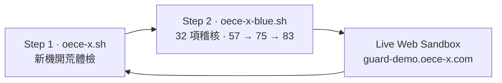
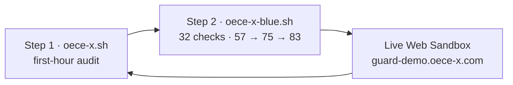

<!--
  oece-x.sh — 3-minute VPS audit and benchmark toolkit
  Sister of oece-x-blue.sh · MIT
-->

<div align="center">


# oece-x.sh

### 3 分鐘 VPS 體檢與基準工具箱
### 3-Minute VPS Audit & Benchmark Toolkit

*先回答這台機器值不值得留。加固交給姊妹面板，這支腳本不下載它。*  
*Decide whether the box is worth keeping. Hardening is the sister panel. This script does not download it.*

<br/>


<br/>

<p>
  <a href="LICENSE"></a>
  
  
  
  
  
  <a href="https://github.com/web3-ai-game/oece-x-blue-sh"></a>
</p>

<p>
  <a href="https://github.com/web3-ai-game/oece-x-sh/stargazers"></a>
  <a href="https://github.com/web3-ai-game/oece-x-sh/network/members"></a>
  
  
  
  
</p>

<p>
  <a href="https://www.youtube.com/@oece-x"></a>
  <a href="https://oece-x.com"></a>
  <a href="https://guard-demo.oece-x.com"></a>
  <a href="https://portfolio.oece-x.com"></a>
</p>

**[繁體中文](#zh) · [English](#en)**

</div>

---

<a id="zh"></a>

# 繁體中文

[English](#en)

## 這支腳本做什麼

`oece-x.sh` 是單檔 Bash 體檢工具。三分鐘內看完 CPU、記憶體、磁碟、BBR、網路握手、回程跳數、Docker socket，以及一份與藍隊面板同口徑的安全初篩。

它不改 sshd，不下載姊妹腳本，沒有隱藏選單，沒有遙測。要加固時，它只印出 [oece-x-blue-sh](https://github.com/web3-ai-game/oece-x-blue-sh) 的 URL。

## 雙子星工作流

Step 1 回答「值不值得留」。Step 2 回答「守不守得住」。兩邊的沙盒主機都是 `DO SGP1`（DigitalOcean · Singapore），分數階梯都是 57 → 75 → 83。



| 步驟 | 倉庫 | 做什麼 |
|:-----|:-----|:-------|
| 1 | [oece-x.sh](https://github.com/web3-ai-game/oece-x-sh) | 新機開荒。硬體、微基準、回程、初篩 57/100 |
| 2 | [oece-x-blue.sh](https://github.com/web3-ai-game/oece-x-blue-sh) | 32 項稽核與可回滾加固，目標 75 / 83 |
| 線上 | [guard-demo.oece-x.com](https://guard-demo.oece-x.com) | 同一套只讀模型。作品集在 [portfolio.oece-x.com](https://portfolio.oece-x.com) |

## 快速開始

| 方式 | 命令 |
|:-----|:-----|
| 免 root 沙盒 | `bash oece-x.sh --demo` |
| 沙盒 JSON | `bash oece-x.sh --demo --audit --json` |
| 正式只讀體檢 | `sudo bash oece-x.sh --audit` |
| 正式 JSON | `sudo bash oece-x.sh --audit --json` |
| 繁體 | `bash oece-x.sh --lang zh-Hant` |
| 英文 | `bash oece-x.sh --lang en` |

```bash
git clone https://github.com/web3-ai-game/oece-x-sh.git
cd oece-x-sh
bash oece-x.sh --demo
```

正式體檢要 Linux root。macOS 與沒有 root 的環境會進入同一套沙盒，不報錯退出。

## 語言

優先序：

1. `--lang zh-Hant` 或 `--lang en`，以及 `OECE_LANG`
2. `/etc/oece-x/lang`
3. `LC_ALL`、`LC_MESSAGES`、`LANG`

`zh_CN` 與其他 `zh*` 一律使用繁體中文。`en*` 使用 English。首次互動且沒有偏好檔時會問一次，10 秒沒輸入就用繁體。`--audit` 不提問。

## 終端預覽

`bash oece-x.sh --demo` 的版面。位址是 [RFC 5737](https://www.rfc-editor.org/rfc/rfc5737) 文件段，不是真實主機。

```text
╔══════════════════════════════════════════════════════════════╗
║  OECE-X · DO SGP1 全景體檢       DigitalOcean · Singapore    ║
╚══════════════════════════════════════════════════════════════╝
只讀沙盒  與 oece-x-blue.sh 共用 57 / 75 / 83 口徑
────────────────────────────────────────────────────────
◆ 系統與硬體
 主機            DO SGP1 (DigitalOcean · Singapore)
 vCPU            DO-Regular Intel 2 vCPU @ 2000 MHz
 記憶體          812 MB / 2048 MB
 Swap            0 MB
 磁碟 (/)        11G / 48G（已用 23%）
 虛擬化          kvm
 內核            6.8.0-demo
 BBR             已啟用（fq + bbr）
◆ 磁碟與 CPU 微基準
 磁碟 4K 讀      41 MB/s
 磁碟 4K 寫      38 MB/s
 磁碟順序讀      286 MB/s
 磁碟順序寫      241 MB/s
 CPU sha256      1.84 秒 / 64 MiB 單核
◆ 網路與回程
 CF 握手         p50 18 ms   p95 27 ms   n=5
 公開 DNS        198.51.100.1   4 跳
 CF 邊緣         203.0.113.10   6 跳
 文件位址        192.0.2.1   樣例，不可路由
◆ Docker 與執行環境
 docker.sock     mode 660  root:docker  只聽本機
◆ 安全基線移交
 初篩            57/100  偏弱  18/32 項
 下一步          oece-x-blue.sh  →  75 / 83
────────────────────────────────────────────────────────
```

`bash oece-x.sh --demo --audit --json` 的契約：

```json
{
  "tool": "oece-x.sh",
  "host": "DO SGP1",
  "specs": {"cpu_cores": 2, "memory_mb": 2048, "virt": "kvm"},
  "benchmark": {"disk_4k_read_mb_s": 41, "cpu_sha256_64mib_s": 1.84},
  "network": {"handshake_p50_ms": 18, "handshake_p95_ms": 27},
  "bbr": {"enabled": true, "qdisc": "fq", "congestion": "bbr"},
  "docker": {"socket_mode": "660", "socket_scope": "local"},
  "security_handoff": {
    "initial_score": 57,
    "target_score": 83,
    "sister_repo": "oece-x-blue-sh"
  }
}
```

## 選單

| # | 模塊 | 會不會改系統 |
|:-:|:-----|:-------------|
| 1 | 系統體檢 | 只讀 |
| 2 | 網路測速 | 只讀；Ookla 要先輸入 `yes` |
| 3 | 回程追蹤 | 只讀 |
| 4 | 安全基線與移交 | 只讀 |
| 5 | CPU / 磁碟 / 記憶體基準 | 磁碟項寫暫存後刪除 |
| 6 | BBR | 啟用要輸入 `yes` |
| 7 | Docker 狀態 | 只讀 |
| 8 | 姊妹藍隊面板 | 只印 URL |
| 9 | 檢查更新 | 只比版本，不覆蓋 |

## 合規

防禦與體檢用途。沒有代理，沒有繞過網路封鎖，沒有遙測。解鎖與延遲數字只代表公開 HTTPS 可達性。

[回到頁首](#oece-xsh) · [English](#en)

---

<a id="en"></a>

# English

[繁體中文](#zh)

## What this is

`oece-x.sh` is a single-file Bash audit. In three minutes it reports CPU, memory, disk, BBR, handshake latency, return-path hops, the Docker socket, and a security baseline that uses the same score ladder as the blue-team panel.

It does not edit sshd, it does not download the sister script, and it has no hidden menu and no telemetry. When you are ready to harden, it prints the URL of [oece-x-blue-sh](https://github.com/web3-ai-game/oece-x-blue-sh).

## Twin toolkit workflow

Step 1 answers whether the box is worth keeping. Step 2 answers whether it can hold. Both sandboxes use `DO SGP1` (DigitalOcean · Singapore) and the ladder 57 → 75 → 83.



| Step | Repo | What it does |
|:-----|:-----|:-------------|
| 1 | [oece-x.sh](https://github.com/web3-ai-game/oece-x-sh) | New-box audit. Hardware, micro-bench, route, initial 57/100 |
| 2 | [oece-x-blue.sh](https://github.com/web3-ai-game/oece-x-blue-sh) | 32-check audit and reversible hardening, toward 75 / 83 |
| Live | [guard-demo.oece-x.com](https://guard-demo.oece-x.com) | The same read-only model. Portfolio: [portfolio.oece-x.com](https://portfolio.oece-x.com) |

## Quick start

| Method | Command |
|:-------|:--------|
| Rootless sandbox | `bash oece-x.sh --demo` |
| Sandbox JSON | `bash oece-x.sh --demo --audit --json` |
| Live read-only audit | `sudo bash oece-x.sh --audit` |
| Live JSON | `sudo bash oece-x.sh --audit --json` |
| Traditional Chinese | `bash oece-x.sh --lang zh-Hant` |
| English | `bash oece-x.sh --lang en` |

```bash
git clone https://github.com/web3-ai-game/oece-x-sh.git
cd oece-x-sh
bash oece-x.sh --demo
```

A live audit needs Linux root. macOS and any non-root shell enter the same sandbox instead of exiting with an error.

## Language

Precedence:

1. `--lang zh-Hant` or `--lang en`, and `OECE_LANG`
2. `/etc/oece-x/lang`
3. `LC_ALL`, `LC_MESSAGES`, then `LANG`

`zh_CN` and every other `zh*` locale use Traditional Chinese. `en*` uses English. The first interactive run with no preference file asks once. Ten seconds of silence keeps Traditional Chinese. `--audit` never prompts.

## TUI preview

Layout of `bash oece-x.sh --demo`. Addresses are [RFC 5737](https://www.rfc-editor.org/rfc/rfc5737) documentation ranges, not a live host.

```text
╔══════════════════════════════════════════════════════════════╗
║  OECE-X · DO SGP1 audit          DigitalOcean · Singapore    ║
╚══════════════════════════════════════════════════════════════╝
read-only sandbox  same 57 / 75 / 83 contract as oece-x-blue.sh
────────────────────────────────────────────────────────
◆ System & Hardware
 Host            DO SGP1 (DigitalOcean · Singapore)
 vCPU            DO-Regular Intel 2 vCPU @ 2000 MHz
 Memory          812 MB / 2048 MB
 Swap            0 MB
 Disk (/)        11G / 48G (23%)
 Virt            kvm
 Kernel          6.8.0-demo
 BBR             on  (fq + bbr)
◆ Disk & CPU micro-benchmark
 Disk 4K read    41 MB/s
 Disk 4K write   38 MB/s
 Disk seq read   286 MB/s
 Disk seq write  241 MB/s
 CPU sha256      1.84 s / 64 MiB single core
◆ Network & return path
 CF handshake    p50 18 ms   p95 27 ms   n=5
 Public DNS      198.51.100.1   4 hops
 CF edge         203.0.113.10   6 hops
 Doc hop         192.0.2.1   unroutable sample
◆ Docker & runtime
 docker.sock     mode 660  root:docker  local only
◆ Security baseline hand-off
 Initial         57/100  Weak  18/32 checks
 Next            oece-x-blue.sh  →  75 / 83
────────────────────────────────────────────────────────
```

Contract of `bash oece-x.sh --demo --audit --json`:

```json
{
  "tool": "oece-x.sh",
  "host": "DO SGP1",
  "specs": {"cpu_cores": 2, "memory_mb": 2048, "virt": "kvm"},
  "benchmark": {"disk_4k_read_mb_s": 41, "cpu_sha256_64mib_s": 1.84},
  "network": {"handshake_p50_ms": 18, "handshake_p95_ms": 27},
  "bbr": {"enabled": true, "qdisc": "fq", "congestion": "bbr"},
  "docker": {"socket_mode": "660", "socket_scope": "local"},
  "security_handoff": {
    "initial_score": 57,
    "target_score": 83,
    "sister_repo": "oece-x-blue-sh"
  }
}
```

## Menu

| # | Module | Writes? |
|:-:|:-------|:--------|
| 1 | System snapshot | read-only |
| 2 | Network speed | read-only; Ookla asks for `yes` first |
| 3 | Return path | read-only |
| 4 | Baseline and hand-off | read-only |
| 5 | CPU / disk / memory bench | disk item writes a temp file, then deletes it |
| 6 | BBR | enabling asks for `yes` |
| 7 | Docker status | read-only |
| 8 | Sister blue-team panel | prints a URL |
| 9 | Update check | compares versions, does not overwrite |

## Boundaries

Inspection only. No proxy, no traffic circumvention, no telemetry. Latency figures are public HTTPS reachability, not a promise about a path.

[Back to top](#oece-xsh) · [繁體中文](#zh)

---

<div align="center">


**MIT License** · [YouTube @oece-x](https://www.youtube.com/@oece-x) · [oece-x.com](https://oece-x.com)

*先看清楚，再交給藍隊。 / Look first. Then hand off.*

</div>
