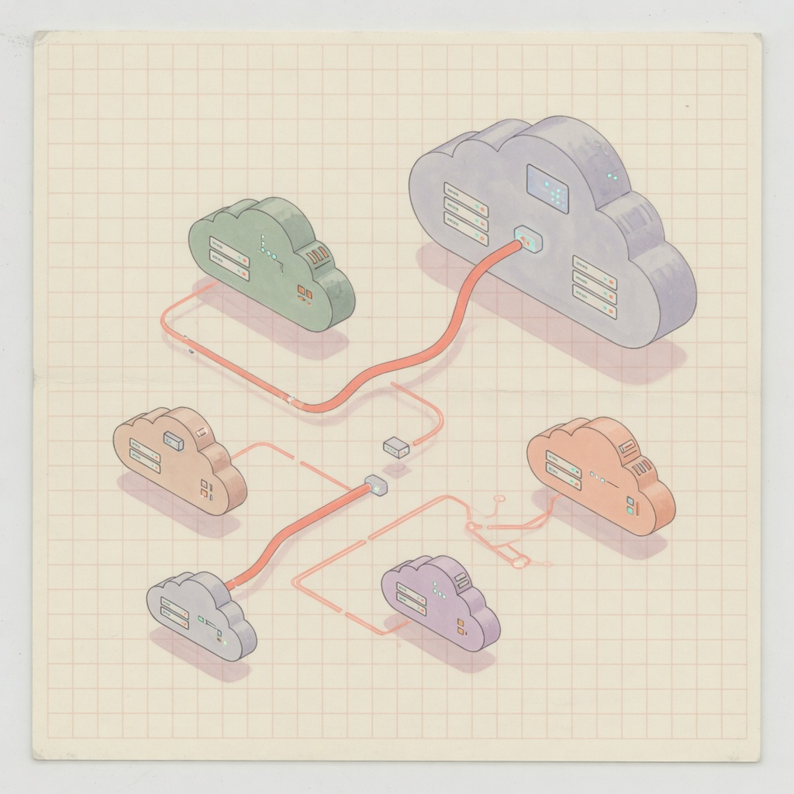

<!--
  oece-x.sh — VPS 體檢 · 加固 · 運維精選
  https://oece-x.com  ·  YouTube @oece-x  ·  MIT
-->

<div align="center">


# 🚀 oece-x.sh

### 3 分鐘判斷一台 VPS 能不能用、值不值；精選運維 + 全網 Top 漢化腳本入口

*A single-file VPS toolkit — inspect, benchmark, unlock-probe, harden SSH, tune BBR, manage Docker, and launch trusted Chinese one-click scripts.*

<br/>


<br/>

<!-- Row 1: build / quality -->
<p>
  <a href="LICENSE"></a>
  
  
  
  
</p>

<!-- Row 2: platform -->
<p>
  
  
  
  
  
  
</p>

<!-- Row 3: social / repo stats -->
<p>
  <a href="https://www.youtube.com/@oece-x"></a>
  <a href="https://oece-x.com"></a>
  <a href="https://github.com/web3-ai-game/oece-x-sh"></a>
  <a href="https://github.com/web3-ai-game/oece-x-sh/commits/main"></a>
</p>

<br/>

<a href="https://oece-x.com">
  
</a>

<br/>

**繁體中文介面 · 單檔可審計 · 彩虹開場動畫 · 危險操作需完整輸入 `yes`**

</div>

---

## ⚡ 快速開始 / Quick Start

> **需要 root**（安裝依賴 / Docker / 路由探測）。本地非 root 會直接拒絕——這是設計，不是 bug。  
> *Root required. Non-root local runs are expected to fail.*

### 一鍵（推薦 / Recommended）

```bash
bash <(curl -sL oece-x.com/x)
```

### 或用 sudo

```bash
sudo bash <(curl -sL oece-x.com/x)
```

### GitHub raw 備用

```bash
bash <(curl -sSL https://raw.githubusercontent.com/web3-ai-game/oece-x-sh/main/oece-x.sh)
```

### 跳過開場動畫 / Skip intro

```bash
OECE_NO_ANIM=1 bash <(curl -sL oece-x.com/x)
# 或 / or:
OECE_FAST=1 bash <(curl -sL oece-x.com/x)
```

| 環境 | 結果 | EN |
|:-----|:-----|:---|
| VPS + root | 進互動選單 | Interactive menu |
| macOS / 本機無 root | 拒絕並提示 sudo | Rejects as designed |
| 管道 / CI 非 TTY | 跳過動畫 | No animation |

---

## 📸 界面預覽 / UI Preview

### 主選單 · Main Menu（v1.3.1）

```text
   ____  ______ ____ ______      __  __
  / __ \|  ____/ ___|  ____|     \ \/ /
 | |  | | |__ | |   | |__   _____ \  /
 | |  | |  __|| |   |  __| |_____|/  \
 | |__| | |___| |___| |____      /  /\ \
  \____/|______\____|______|    /__/  \_\
  oece-x.sh v1.3.1 · 體檢 · 加固 · 運維精選
  YouTube @oece-x · oece-x.com · bash <(curl -sL oece-x.com/x)

── 體檢與網路 ──
 1) 系統體檢 ★          CPU/記憶體/虛擬化/BBR/IP
 2) 性能跑分 ★          CPU · 磁碟 · 記憶體 · nench
 3) 解鎖/IP 質量 ★      Netflix · ChatGPT 可達性
 4) 網路測速            Cloudflare · Ookla
 5) 回程路由            三網 NextTrace

── 系統運維 ──
 6) 系統更新            apt / dnf / yum
 7) 系統清理            緩存 · journal
 8) BBR 加速 ★          開機第一件事
 9) Swap ★              小內存剛需
10) 時區/DNS
11) 基礎工具            curl vim htop fail2ban
12) SSH 安全加固 ★      端口 · fail2ban · UFW · vps-audit

── Docker ──
13) Docker 環境 ★       安裝 / 卸載 / 狀態
14) 容器管理
15) 鏡像清理            prune

── 站點輕量 ──
16) nginx 反代 ★        域名 → 上游
17) SSL 證書            certbot 輔助
18) 部署 Demo           驗證頁

── 工具箱 ──
19) 精選腳本入口 ★      審計 · nench · 融合怪 · 換源
20) 檢查更新
21) 快捷命令 x
22) 卸載
 0) 退出
```

### 官網 / Landing

<p align="center">
  
  
</p>

<p align="center">
  <a href="https://oece-x.com/#script"></a>
</p>

---

## 🧰 功能總覽 / Feature Matrix

| # | 模塊 ZH | EN | 說明 |
|:-:|:--------|:---|:-----|
| **1** | **系統體檢** ★ | Host snapshot | CPU / RAM / 虛擬化 / BBR / 公網 IP·ASN |
| **2** | **性能跑分** ★ | Bench | CPU · 磁碟 · 記憶體；可進 nench |
| **3** | **解鎖/IP 質量** ★ | Unlock probe | Netflix / Disney+ / ChatGPT / OpenAI API 可達性（**無代理**） |
| 4 | 網路測速 | Speedtest | Cloudflare 純 curl；可選 Ookla |
| 5 | 回程路由 | Return path | 三網 · NextTrace（SHA256 釘版） |
| 6 | 系統更新 | Distro upgrade | apt / dnf / yum |
| 7 | 系統清理 | Cleanup | 包緩存 · journal |
| **8** | **BBR 加速** ★ | Enable BBR | `fq` + `bbr` · `/etc/sysctl.d` |
| **9** | **Swap** ★ | Swapfile | 建立 / 刪除 + fstab |
| 10 | 時區 / DNS | TZ & DNS | timedatectl · 公共 DNS |
| 11 | 基礎工具 | Essentials | git vim htop fail2ban… |
| **12** | **SSH 安全加固** ★ | SSH harden | 改端口 · 禁密碼 root · fail2ban · UFW · 審計 |
| **13** | **Docker 環境** ★ | Docker | 官方 get.docker.com · 狀態 / 卸載 |
| 14 | 容器管理 | Containers | start / stop / logs |
| 15 | 鏡像清理 | Prune | docker system prune |
| **16** | **nginx 反代** ★ | Reverse proxy | 獨立 conf；默認保護生產域名 |
| 17 | SSL 證書 | Certbot | nginx / standalone 輔助 |
| 18 | 部署 Demo | Demo page | 驗證反代 |
| **19** | **精選腳本入口** ★ | Script hub | 換源 · 融合怪 · kejilion · **vps-audit** · **nench** |
| 20 | 檢查更新 | Self-update | 對比遠端版本 |
| 21 | 快捷命令 `x` | Shortcut | 全局快捷入口 |
| 22 | 卸載 | Uninstall | 清腳本產物（不動業務容器） |

---

## 🎬 開場動畫 / Intro Animation

TTY 下約 **1.5–2.5 秒**：

1. 大號 **OECE-X** 塊字 + **256 色彩虹色波**（類 hydra / lolcat 開場）  
2. 底部蛇形 loading 條  
3. 定格雙色 Logo + 版本框  

| 條件 | 行為 |
|:-----|:-----|
| `OECE_NO_ANIM=1` 或 `OECE_FAST=1` | 直接進選單 |
| 非 TTY（管道 / CI） | 跳過動畫 |
| 正常 SSH TTY | 播放完整開場 |

---

## 🌐 精選腳本入口（選單 19）/ Trusted Launchers

按 **GitHub 熱度 + 中文界面 + 有 VPS 即可 curl** 篩選（非付費推廣；star 數隨時間浮動）：

| # | 項目 | 約 stars | 用途 | 官方一鍵 |
|:-:|:-----|:--------:|:-----|:---------|
| 1 | [SuperManito/LinuxMirrors](https://github.com/SuperManito/LinuxMirrors) | ~7.6k | 換軟體源 / Docker 源 | `bash <(curl -sSL https://linuxmirrors.cn/main.sh)` |
| 2 | [spiritLHLS/ecs](https://github.com/spiritLHLS/ecs) 融合怪 | ~7.0k | 綜合伺服器測評（中文菜單） | `curl -L …/ecs.sh -o ecs.sh && bash ecs.sh` |
| 3 | [kejilion/sh](https://github.com/kejilion/sh) | ~3.0k | 全能運維（**繁中 tw**） | `bash <(curl -sL kejilion.sh) tw` |
| 4 | [vernu/vps-audit](https://github.com/vernu/vps-audit) | ~2.3k | **無依賴安全審計** | raw `vps-audit.sh` |
| 5 | [n-st/nench](https://github.com/n-st/nench) | classic | CPU / IO / 網路經典測評 | `nench.sh` |

### 安全模型 / Safety model

```text
下載 HTTPS → bash -n 語法校驗 → 完整輸入 yes 二次確認 → 執行
```

- **不內嵌**對方源碼 · *Upstream is not vendored*  
- 第三方腳本可能含本項目刻意不做的功能（如 WARP 等），請自行甄別  
- *We only launch trusted one-liners after syntax check + confirmation.*

---

## 🔒 安全設計 / Security Design

| 項 | 說明 | EN |
|:---|:-----|:---|
| 單檔開源 | 無混淆、可全文審計 | Single file, no obfuscation |
| HTTPS-only | `safe_download` | HTTPS downloads only |
| 釘版校驗 | NextTrace SHA256 | Pinned binary checksum |
| 危險確認 | 必須完整輸入 `yes` | Full `yes` for destructive ops |
| 生產保護 | `oece-x.com` / `api.oece-x.com` 額外確認 | Extra confirm on prod domains |
| 無遙測 | 不收集數據 | No telemetry |
| **無翻牆** | **不含代理 / WARP / Argo** | **No proxy / WARP / Argo** |

---

## 📦 系統需求 / Requirements

- **OS**: Debian 10+ / Ubuntu 20.04+ / RHEL 系 8+  
- **Arch**: `amd64` · `arm64`  
- **權限**: `root` 或 `sudo`  
- **依賴**: `curl` + `tar`（其餘按需安裝）  

---

## ❓ FAQ

<details>
<summary><b>為什麼本機 curl 測試會失敗？ / Why does local non-root fail?</b></summary>

腳本需要 root 才能裝依賴、Docker、改 sysctl / SSH。  
Mac 或普通用戶下提示「請用 sudo」是**預期行為**，請在 **VPS** 上跑。

*Root is required by design. Run on a VPS with sudo.*
</details>

<details>
<summary><b>為什麼接第三方腳本而不是全抄進來？</b></summary>

融合怪 / 換源 / kejilion 體量巨大且更新快。做**校驗後啟動器**更安全、更好維護，也尊重上游。

*Launchers beat vendoring huge upstream scripts.*
</details>

<details>
<summary><b>會不會動我現有的生產站？</b></summary>

反代模塊對 `oece-x.com` / `api.oece-x.com` 會額外危險確認。主卸載**不動**業務 Docker 容器。
</details>

<details>
<summary><b>v1.1 的 Sub2API 呢？</b></summary>

已在 **v1.2 整段移除**（與工具箱定位不符）。生產環境若有 Sub2API，請用你自己的 compose，與本腳本無關。
</details>

<details>
<summary><b>解鎖檢測是不是翻牆？</b></summary>

**不是。** 僅對 Netflix / ChatGPT 等做 HTTP 可達性探測，**不部署任何代理或隧道**。
</details>

---

## 🗺️ Roadmap

- [x] v1.2 — 精選運維 + 酷炫動畫 + Top 漢化入口  
- [x] v1.3 — 性能跑分 · 解鎖探測 · SSH 加固 · vps-audit / nench  
- [x] v1.3.1 — 彩虹 Logo 開場 + 菜單 1–22 定稿  
- [ ] 體檢結果 Markdown / JSON 導出  
- [ ] 更多回程節點預設  
- [ ] 可選裝機計數器（隱私優先）  

---

## ⚠️ 免責 / Disclaimer

僅供 **VPS 測試與合法運維**。測速 / 路由 / 解鎖結果僅供參考。  
**不含任何繞過網路封鎖之功能。**  
第三方腳本的行為與授權以其上游項目為準。使用風險自負。

*For legitimate VPS ops only. No circumvention features. Upstream scripts are their authors’ responsibility.*

---

## 📺 連結 / Links

| | |
|:--|:--|
| 官網 | [oece-x.com](https://oece-x.com) · [腳本專區](https://oece-x.com/#script) |
| YouTube | [@oece-x](https://www.youtube.com/@oece-x) |
| GitHub | [web3-ai-game/oece-x-sh](https://github.com/web3-ai-game/oece-x-sh) |
| 開發回執 | [docs/DEV-HANDOFF.md](docs/DEV-HANDOFF.md) |
| Profile | [web3-ai-game](https://github.com/web3-ai-game) |

---

## 📄 License

[MIT](LICENSE) © [oece-x](https://oece-x.com) / [DeepWeay Labs](https://github.com/web3-ai-game)

<div align="center">

<br/>


**`bash <(curl -sL oece-x.com/x)`**

</div>
